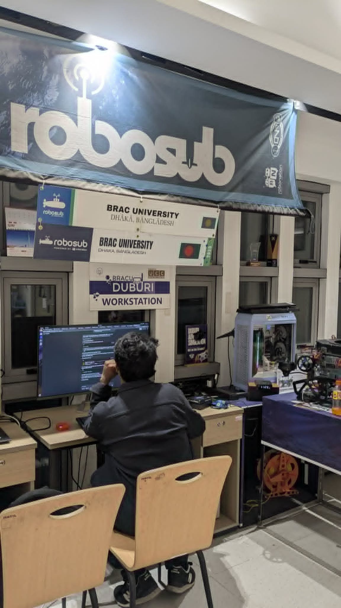
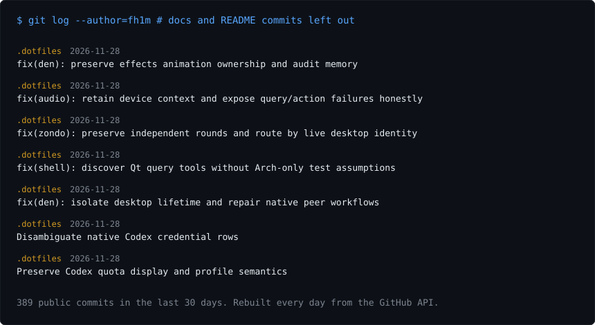
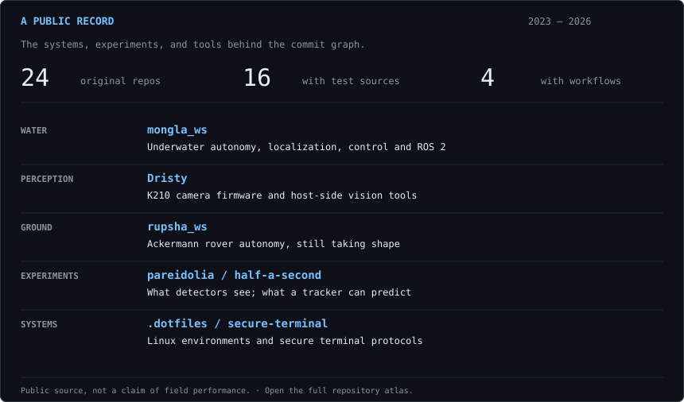

<em>the robotics lab, one of the later nights.</em>
 

# fh1m

**Autonomy engineer.** Machines that perceive, reason, and act — built to still operate after everyone who could check on them has gone home.

Dhaka, Bangladesh · [fh1m.github.io](https://fh1m.github.io)

<picture>
  <source media="(prefers-color-scheme: dark)" srcset="https://raw.githubusercontent.com/fh1m/fh1m/output/snake-dark.svg">
  <source media="(prefers-color-scheme: light)" srcset="https://raw.githubusercontent.com/fh1m/fh1m/output/snake-light.svg">
  
</picture>

 

I learned in the wrong order: first the thing that leaves the ground, where a mistake is instant and expensive, then things that drive, then things that swim. Water was the hardest teacher. It never argues and never waits for a patch; it just stops returning what you expected, and you work out alone whether the sensor lied or the world changed.

### Receipts

<picture>
  <source media="(prefers-color-scheme: dark)" srcset="https://raw.githubusercontent.com/fh1m/fh1m/output/ledger-dark.svg">
  <source media="(prefers-color-scheme: light)" srcset="https://raw.githubusercontent.com/fh1m/fh1m/output/ledger-light.svg">
  
</picture>

 

<a href="https://github.com/fh1m/fh1m/blob/output/evidence.md" title="Inspect the source evidence">
<picture>
  <source media="(prefers-color-scheme: dark)" srcset="https://raw.githubusercontent.com/fh1m/fh1m/output/evidence-dark.svg">
  <source media="(prefers-color-scheme: light)" srcset="https://raw.githubusercontent.com/fh1m/fh1m/output/evidence-light.svg">
  
</picture>
</a>

&nbsp;

| | |
|---|---|
| **BRACU Duburi** | Engineering Team Lead for RoboSub 2026; vision before that. 8th of 58 at RoboSub in 2025 and 2026. Co-author of both Technical Design Reports. |
| **[Mongla](https://github.com/fh1m/mongla_ws)** | An autonomy stack for underwater vehicles where every number carries the measurement that produced it. |
| **[Dristy](https://github.com/fh1m/Dristy)** | Open firmware that makes a K210 camera do the seeing, so the robot gets an answer instead of a picture. |
| **[SROT / Hengla](https://github.com/RakibulIslam1/srot-control-board)** | Contributor to Rakibul Islam's AUV control board and firmware, and its ground station, Bondor. |
| **[Everything else](https://fh1m.github.io/everything)** | Rockets, rovers, a camera that grades its own interviews, and the lessons each one cost. |

### a few things I hold as load-bearing

* A system I didn't build, I don't extend blind. I take it apart until I can explain every piece back in my own words.
* A claim without a method attached is a rumor wearing a lab coat.
* Hardware doesn't negotiate. You can argue with a product manager; you cannot argue with a thruster that draws more current than the ESC can source.

> A heartbeat message tells you the wire is fine. It has never once told you the propeller is still attached to the shaft.

 

I love uncle shifu & B99 hehe. Reach me at <strong>fh1m.faisal.work@gmail.com</strong>.

