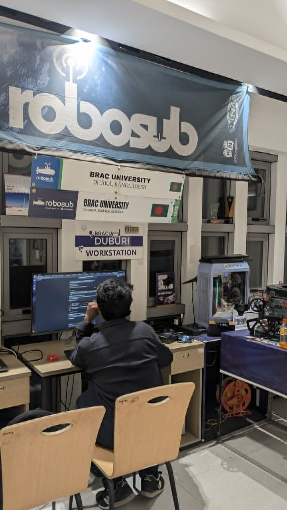

<em>the robotics lab, one of the later nights.</em>
 

# fh1m

**Autonomy engineer.** Machines that perceive, reason, and act — built to still operate after everyone who could check on them has gone home.

Dhaka, Bangladesh · [fh1m.github.io](https://fh1m.github.io)

### On the bench

| Project | My role | Demonstrated result | Validation |
|---|---|---|---|
| [Mongla](https://github.com/fh1m/mongla_ws) | Autonomy-stack maintainer | ROS Humble/Jazzy CI passing; board and Hailo bench evidence linked in the capability map | Bench/software evidence. The current vehicle has never been in water. |
| [Rupsha](https://github.com/fh1m/rupsha_ws) | Author, rover autonomy stack | Simulation and board-contract work; earlier skid/Pixhawk results kept separate | Current Ackermann chassis has no outdoor validation. CI presently needs repair. |
| [Dristy](https://github.com/fh1m/Dristy) | Firmware and host-API co-author | K210/SEN0305 live-board captures and mode-audit records | Hardware-bench evidence; development paused. |
| [Digital Den](https://github.com/fh1m/.dotfiles) | Workstation maintainer | A documented two-host workbench with cross-host validation receipts | Daily-use/host evidence; clean-runner CI presently needs repair. |

<picture>
  <source media="(prefers-color-scheme: dark)" srcset="https://raw.githubusercontent.com/fh1m/fh1m/output/snake-dark.svg">
  <source media="(prefers-color-scheme: light)" srcset="https://raw.githubusercontent.com/fh1m/fh1m/output/snake-light.svg">
  
</picture>

 

My training runs backwards from most engineers I know. I didn't start on the ground and work my way out  I started with the thing that has to leave the ground, where a mistake is instantly visible and instantly expensive. Then I came down to things that walk. Then I went under things that swim, which turned out to be the hardest teacher of the three, because water doesn't argue with you and it doesn't wait for a patch. It just stops returning what you expected and leaves you to work out, alone, whether the sensor lied or the world changed.

That's the actual job, underneath the ROS nodes and the control loops: deciding what a machine is allowed to believe about a world it can't fully see, and building the discipline into the code so the machine never believes more than it has earned.

 

<picture>
  <source media="(prefers-color-scheme: dark)" srcset="assets/rule-dark.svg">
  <source media="(prefers-color-scheme: light)" srcset="assets/rule-light.svg">
  
</picture>

### a few things I hold as load-bearing

* A system I didn't build, I don't extend blind — I take it apart until I can explain every piece back in my own words, and only then do I trust it with something that matters.

* A claim without a method attached isn't a fact yet. It's a rumor wearing a lab coat, and I treat it that way until it earns better.

* Working once, under ideal conditions, in a demo, isn't engineering. It's a coin flip with good lighting. The version that counts is the one that still works on the night nobody's filming.

* Hardware doesn't negotiate. You can argue with a product manager; you cannot argue with a thruster that draws more current than the ESC can source. I like that. It's the most honest collaborator I've worked with.

 

  > A heartbeat message tells you the wire is fine. It has never once told you the propeller is still attached to the shaft.

 

<picture>
  <source media="(prefers-color-scheme: dark)" srcset="assets/rule-dark.svg">
  <source media="(prefers-color-scheme: light)" srcset="assets/rule-light.svg">
  
</picture>

 
 

*Ship the version that's honest. Make it fast after. then better. the loop*

 

I love uncle shifu & B99 hehe. Reach me at <strong>fh1m.faisal.work@gmail.com</strong>.

